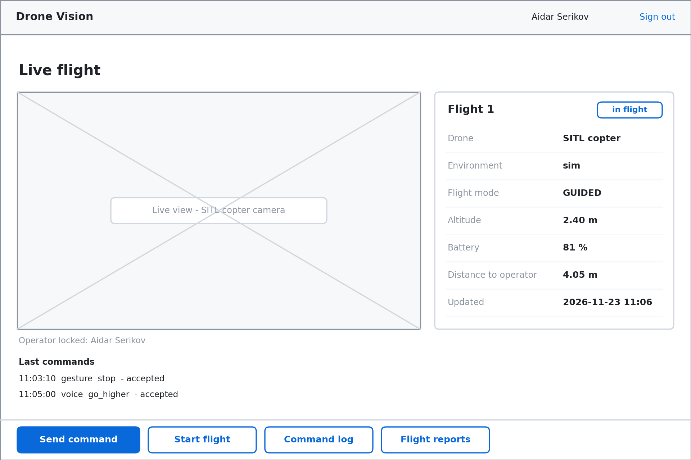

<div align="center">

# Autonomous Drone Vision

**Select an object on the screen, and the drone follows it on its own: at a safe distance, around obstacles, with
every flight recorded.**

[](https://github.com/fonneyx/autonomous-drone-vision/actions/workflows/ci.yml)
[](https://github.com/fonneyx/autonomous-drone-vision/releases)


[Features](#features) · [How it works](#how-it-works) · [Quick start](#quick-start) ·
[Project structure](#project-structure) · [Documentation](docs/README.md)



<sub>Live flight dashboard - design wireframe</sub>

</div>

Autonomous Drone Vision is a ground-station system for ArduPilot drones. A laptop runs the perception and the
decisions, and the drone only needs a flight controller, a camera link and a radio. The same code drives ArduPilot
SITL in simulation and a real low-cost quad.

> **Safety and scope.** The drone follows only allowed targets: its operator, people who agreed to be followed, and
> the operator's own vehicles. It keeps at least 5 m away, never closes in, hovers when unsure, and the RC
> transmitter can always take over. Aircraft and animals are never targets.

## Features

| | | Status |
|---|---|---|
| **Tap to track** | Pick a person or vehicle on the live video; YOLO11 tracking with re-identification keeps the lock through occlusions. | Operator lock built; any object next |
| **Autonomous follow** | Keeps distance and bearing to the target inside a safety envelope: minimum distance, speed limit, geofence, hover on lost lock. | Built (simulated output) |
| **Obstacle avoidance** | An RL pilot (PPO, 99 % success at 40 obstacles in MuJoCo), a classical follow-the-gap pilot and a safety shield; depth from one camera. | Pilots built; camera depth next |
| **Voice control** | Offline Vosk commands: follow, stop, come back, land. Hand gestures are optional at short range. | Built |
| **Command arbiter** | One place decides what the drone does, by priority, and logs every decision with its reason. | Built |
| **ArduPilot link** | MAVLink in GUIDED mode; SITL and real vehicles behind one adapter. | Next |
| **Monitoring** | HUD-style live dashboard: video with boxes, lock confidence, mode, attitude, map and flight path. | [Designed](docs/ui/README.md) |
| **Flight recorder** | PostgreSQL record of flights, telemetry, tracks and decisions, for replay and reports. | [Schema ready](docs/database/README.md) |

## How it works

```
camera ──► detect + track (YOLO11) ──► target lock (re-ID) ◄── operator selects a target (dashboard or voice)
                                              │
              follow controller ──► avoidance pilot ──► safety shield ──► MAVLink GUIDED ──► ArduPilot
                                                                                               (SITL or real)
every stage ──► flight recorder ──► PostgreSQL ──► dashboard, replay, reports
```

ArduPilot keeps the aircraft stable. The laptop only sends bounded velocity setpoints, and the safety shield can
always override the pilots. The database records what happened and never sits in the control loop. Details are in
[the architecture](docs/architecture.md).

## Quick start

Python 3.11+ on Windows, Linux or macOS.

```bash
git clone https://github.com/fonneyx/autonomous-drone-vision.git
cd autonomous-drone-vision
python -m venv .venv
.venv\Scripts\activate                    # Linux/macOS: source .venv/bin/activate
pip install -e . --group dev             # or: uv sync
python scripts/tools/download_models.py  # trained avoidance pilot from the release
```

For an NVIDIA GPU, install the CUDA build of PyTorch first ([pytorch.org](https://pytorch.org)), then check it
with `python scripts/tools/check_gpu.py`.

```bash
python scripts/demo/webcam_followme.py      # operator tracking, voice and gestures on a webcam
python scripts/demo/fly_avoidance.py        # watch the RL pilot fly the obstacle course
python scripts/eval/report_commands.py      # accuracy and latency report from results/commands
python -m pytest -q                         # run the tests
```

## Project structure

```
src/dronevision/    core package
  perception/       detector, tracker, target lock (re-ID), gestures
  control/          arbiter, follow controller, pilots, safety shield
  voice/            offline voice commands
  sim/              MuJoCo training environment
  evaluation/       command trials and reports
configs/            runtime settings
models/             model list; weights come from releases
scripts/            demo, train, eval, tools, docs (diagram and wireframe builders)
results/            published measurement results
tests/              unit tests
docs/               architecture, requirements, analysis, database, interface, hardware
```

## Documentation

- [Architecture](docs/architecture.md): components, tap to track, avoidance, vehicles, measurements
- [Requirements](docs/requirements.md) · [Analysis diagrams](docs/analysis/README.md) ·
  [Database](docs/database/README.md) · [Interface design](docs/ui/README.md) · [Hardware](docs/hardware.md)

## Contributing

See [CONTRIBUTING.md](CONTRIBUTING.md). Report security issues privately as described in [SECURITY.md](SECURITY.md).

## License

All rights reserved. See [LICENCE](LICENCE). Third-party models keep their own licences (Ultralytics YOLO is
AGPL-3.0).
