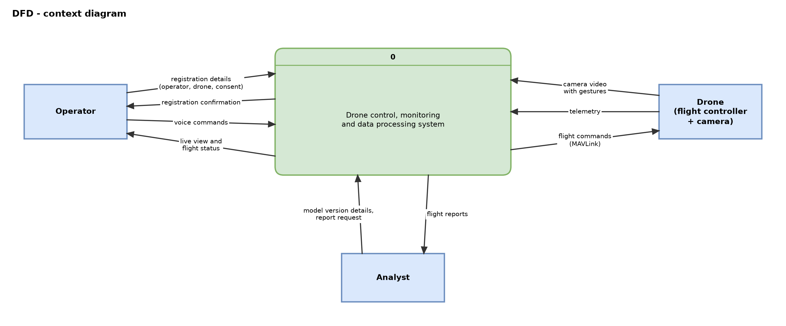

<div align="center">

# Autonomous Drone Vision

**Intelligent drone control, monitoring and data processing.**
A drone that follows its operator, obeys hand gestures and voice commands, and records every flight, command and
decision for live monitoring and analysis.

[](https://github.com/fonneyx/Autonomous-Drone-Vision/actions/workflows/ci.yml)


[Purpose](#purpose) · [Features](#features) · [Users](#users) · [Requirements](#requirements) ·
[How it works](#how-it-works) · [Quick start](#quick-start) · [Documentation](#documentation) · [Roadmap](#roadmap)

</div>

## Purpose

Let one person control a drone hands-free with gestures and voice, while the system checks that every command
really comes from that person and keeps a complete, queryable record of each flight.

## Features

| | |
|---|---|
| **Follow-me tracking** | YOLO11-pose finds people; re-identification keeps locked on *the operator*, not a passer-by. |
| **Gesture control** | MediaPipe: open palm = stop, fist = land, wave = come back. Gestures must be held, so random movement does not trigger them. |
| **Voice control** | About 10 offline commands with Vosk ("follow me", "go higher", "take a photo", ...) from a phone or headset microphone. |
| **Command arbiter** | One place decides what the drone does: safety > land/stop > voice/gesture > follow. Every decision is logged with its reason. |
| **Obstacle avoidance** | An RL pilot (PPO, MuJoCo) with a classical follow-the-gap baseline and a rule-based safety shield. |
| **Monitoring** | Live view, flight mode, battery, altitude and distance to the operator (web dashboard in progress). |
| **Data processing** | PostgreSQL stores flights, telemetry, commands, decisions and model versions; reports show accuracy, latency and flight summaries. |
| **Same code, sim or real** | MAVLink to ArduPilot: the simulator (SITL) and a real low-cost drone use the same interface. |

## Users

| User | What they do with the system |
|---|---|
| **Operator** | Registers and gives consent, controls the drone with gestures and voice, watches the live view and flight status. |
| **Analyst** | Registers model versions, requests flight reports: command accuracy, latency, flight history. |
| **Drone** *(external system)* | Flight controller (ArduPilot) + camera: sends video and telemetry, receives flight commands over MAVLink. |

These are the external entities of the [data flow diagrams](docs/analysis/README.md).

## Requirements

| ID | Requirement |
|---|---|
| R1 | The operator registers with a full name, an email and recorded consent before the first flight. |
| R2 | The analyst registers drones and ML model versions (name, task, version, file hash). |
| R3 | The operator starts a flight by choosing a drone and the environment (simulator or real). |
| R4 | The system accepts gesture and voice commands only from the identified operator; commands from anyone else are rejected and logged with the reason. |
| R5 | The operator lands or stops the drone with a held gesture (fist = land, open palm = stop), a voice command or a dashboard button. |
| R6 | The system sends accepted commands to ArduPilot over MAVLink and records telemetry (flight mode, altitude, battery, distance to the operator). |
| R7 | The operator sees the live view, the flight status and the command log on the dashboard. |
| R8 | The analyst views flight reports: command accuracy and latency by source, and the models used in each flight. |

## How it works

```
 phone/headset mic ──► voice commands (Vosk) ─────────────┐
 drone camera ──► YOLO11-pose tracking + operator re-ID   │
             └──► MediaPipe gestures ─────────────────────┤
 distance sensor ──► obstacles ───────────────────────────┤
                                                          ▼
        Command arbiter (SAFETY > LAND/STOP > voice/gesture > follow) ──► PostgreSQL
                                                          ▼                 (flights, telemetry,
        Follow controller + RL pilot → bounded velocity commands             commands, decisions)
                                                          ▼                      │
        Safety shield (min distance, max speed, stop and hover when unsure)      ▼
                                                          ▼               reports · dashboard
        MAVLink → ArduPilot (GUIDED mode) → motors
```

The machine-learning pilot never drives the motors: ArduPilot keeps the drone stable, the pilot only sends bounded
velocity commands, and the safety shield can always override it.

<p align="center"></p>

## Quick start

Python 3.11+ on Windows, Linux or macOS.

```bash
git clone https://github.com/fonneyx/Autonomous-Drone-Vision.git
cd Autonomous-Drone-Vision
python -m venv .venv
.venv\Scripts\activate                 # Linux/macOS: source .venv/bin/activate
pip install -e . --group dev          # or: uv sync
```

For an NVIDIA GPU, install the CUDA build of PyTorch first ([pytorch.org](https://pytorch.org)), then check it
with `python scripts/tools/check_gpu.py`.

```bash
python scripts/demo/webcam_followme.py                      # follow-me on a webcam + microphone
python scripts/demo/fly_avoidance.py                        # watch the RL pilot fly the obstacle course
python scripts/eval/measure_commands.py --source gesture    # measure gesture accuracy at 1/2/3/5 m
python scripts/eval/report_commands.py                      # accuracy and latency report
psql -v ON_ERROR_STOP=1 -f docs/database/schema.sql         # create the database with test data
python -m pytest -q                                         # run the tests
```

## Project structure

```
src/dronevision/     Python package
  perception/        person tracking, operator re-ID, gestures, YOLO detector
  voice/             offline voice commands
  control/           command arbiter, follow controller, classical pilot, safety shield
  evaluation/        command trials and their statistics
  sim/               MuJoCo worlds for the RL pilot
  link/  storage/    MAVLink link and flight recorder (in progress)
backend/  frontend/  API and web dashboard (planned)
scripts/             demo, eval, train, data, tools, docs (diagram and database builders)
tests/unit/          pytest tests
docs/                analysis (DFD), database (ERD, SQL), architecture, hardware
config/  assets/     settings, 3D models for the simulator
```

## Documentation

**Analysis** - [overview and balancing](docs/analysis/README.md)

- Activity diagram - land by gesture: [PNG](docs/analysis/activity-land-by-gesture.png) · [draw.io](docs/analysis/activity-land-by-gesture.drawio)
- Sequence diagram - land by gesture: [PNG](docs/analysis/sequence-land-by-gesture.png) · [draw.io](docs/analysis/sequence-land-by-gesture.drawio)
- DFD context diagram: [PNG](docs/analysis/dfd-context.png) · [draw.io](docs/analysis/dfd-context.drawio)
- DFD level 0: [PNG](docs/analysis/dfd-level0.png) · [draw.io](docs/analysis/dfd-level0.drawio)
- DFD level 1 - 2.0 Recognize operator commands: [PNG](docs/analysis/dfd-level1.png) · [draw.io](docs/analysis/dfd-level1.drawio)

**Database** - [overview](docs/database/README.md)

- ER diagram: [PNG](docs/database/erd.png) · [draw.io](docs/database/erd.drawio)
- Schema, test data and queries: [schema.sql](docs/database/schema.sql)
- Query results: [query-results.png](docs/database/query-results.png)

**Design**

- [Architecture and roadmap](docs/architecture.md) · [Hardware](docs/hardware.md) · [Requirements](docs/requirements/README.md)

## Roadmap

| Part | Status |
|---|---|
| RL obstacle-avoidance pilot in MuJoCo (PPO) | ✅ 99 % success at 40 obstacles |
| Classical pilot + safety shield | ✅ |
| Webcam follow-me: tracking, re-ID, gestures, voice, arbiter | ✅ live-tested |
| Gesture/voice measurement tools (accuracy by distance, latency) | ✅ |
| Data model: DFD, ERD, PostgreSQL schema | ✅ |
| MAVLink link + ArduPilot SITL | ⏳ next |
| Flight recorder writing to PostgreSQL, audit log | ⏳ |
| Backend API + live web dashboard | ⏳ |
| Follow-me in simulation (moving operator, wind, noise, latency) | ⏳ |
| Real drone: bench tests with propellers off | ⏳ |

## Safety

Manual RC override and ArduPilot failsafes are set up before any autonomous flight. Speed is limited, the drone
keeps a minimum distance to people, and anything unclear (operator lost, conflicting commands) means **stop and
hover**. The drone follows only its own registered operator.

## Contributing

Issues and pull requests are welcome. Run `python -m pytest -q` before opening a pull request, and keep one
change per pull request.

## License

All rights reserved - see [LICENCE](LICENCE). Third-party models keep their own licences (Ultralytics YOLO:
AGPL-3.0).
