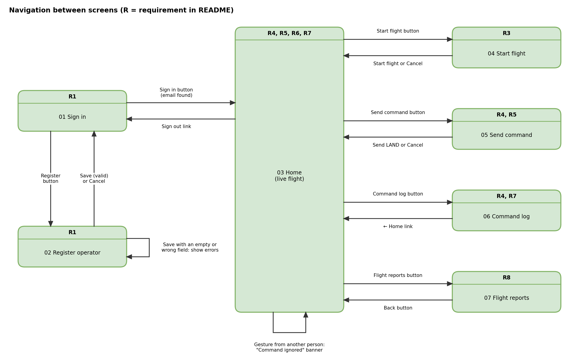

# Interface design

These are wireframes of the web dashboard, generated with `python scripts/docs/build_ui.py`. Each screen is a
`.drawio` file plus a `.png`. Form fields follow the columns of [schema.sql](../database/schema.sql), and the lists
show its test data.

## Navigation

[PNG](navigation.png) · [draw.io](navigation.drawio)

## Traceability

Requirement IDs refer to [requirements](../requirements.md).

| Screen | Requirement | Table | Columns |
|---|---|---|---|
| [01 Sign in](screens/01-sign-in.png) | R1 | operator | email |
| [02 Register operator](screens/02-register.png) · [with errors](screens/02-register-errors.png) | R1 | operator | full_name, email, consent_given_at, template_path |
| [03 Home - live flight](screens/03-home.png) · [command ignored](screens/03-home-command-ignored.png) | R4, R5, R6, R7 | flight, telemetry_sample, drone, command_event | flight_id, environment; flight_mode, altitude_m, battery_pct, distance_to_operator_m, recorded_at; name; command, decision |
| [04 Start flight](screens/04-start-flight.png) | R3 | flight, flight_model, drone, ml_model | operator_id, drone_id, environment, started_at; model_id |
| [05 Send command](screens/05-send-command.png) | R4, R5 | command_event | flight_id, command, reason, source, created_at (decision set by the arbiter) |
| [06 Command log](screens/06-command-log.png) | R4, R7 | command_event, flight, operator, drone | created_at, source, command, decision, reason; full_name; name |
| [07 Flight reports](screens/07-flight-reports.png) | R8 | flight, flight_model, ml_model, telemetry_sample, command_event | queries Q2 and Q3 in schema.sql |

## Colours

The interface uses five colours. Each status value always has the same colour, on every screen.

| Colour | Hex | Used for |
|---|---|---|
| Green | `#1a7f37` | `command_event.decision = 'accepted'` |
| Red | `#cf222e` | `command_event.decision = 'rejected'`, error and validation messages |
| Blue | `#0969da` | flight in the air (`flight.ended_at IS NULL`), buttons and links |
| Grey | `#8c959f` | flight ended (`flight.ended_at` set), hints, read-only fields |
| Ink | `#1f2328` | text |

## Errors

When a gesture comes from someone other than the operator (the `else` branch of the
[sequence diagram](../analysis/sequence-land-by-gesture.png)), Home shows a "Command ignored" banner. The banner
says who may give commands and how to try again.

The registration form checks the full name (empty), the email (format) and the consent box before saving.

## Evaluation

The design was checked in a [usability test with a first-time user](evaluation.md).
